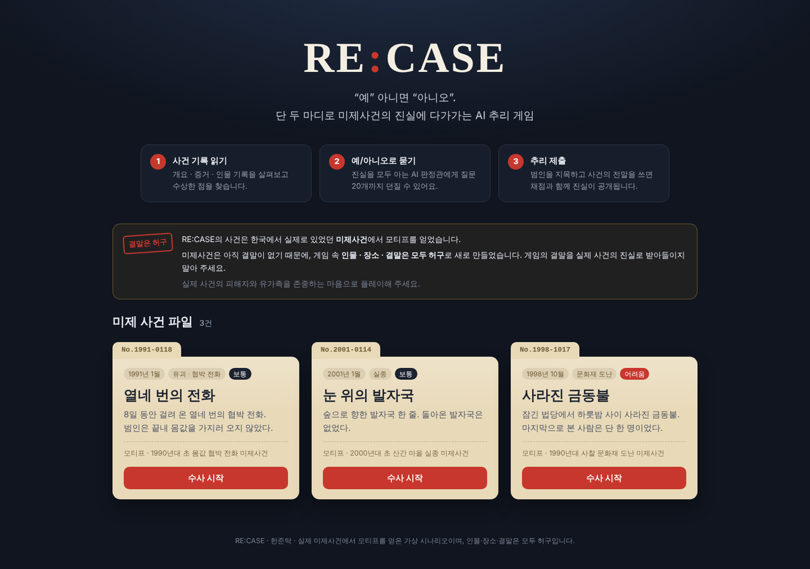
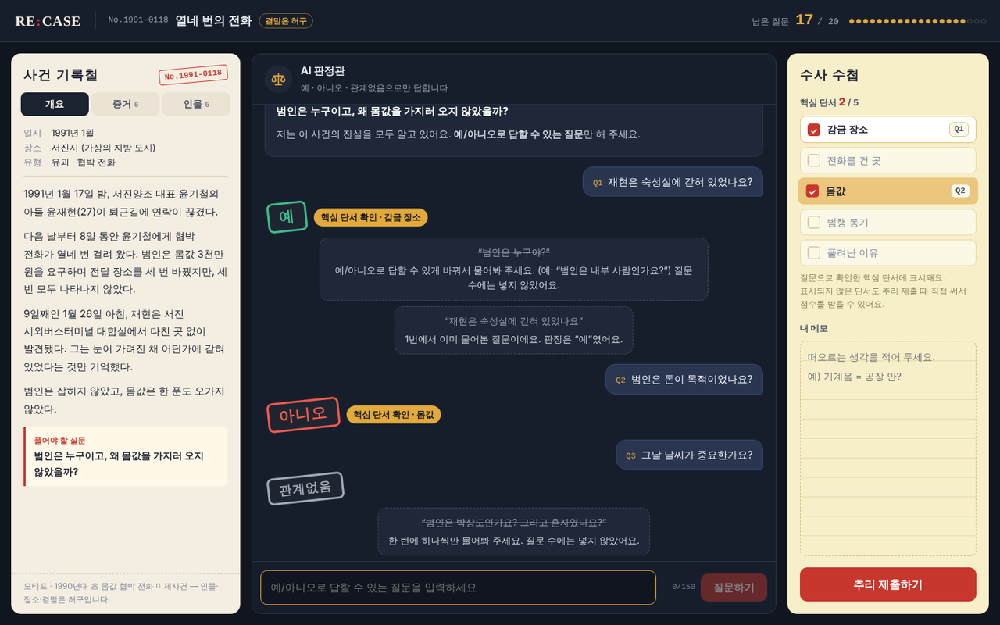
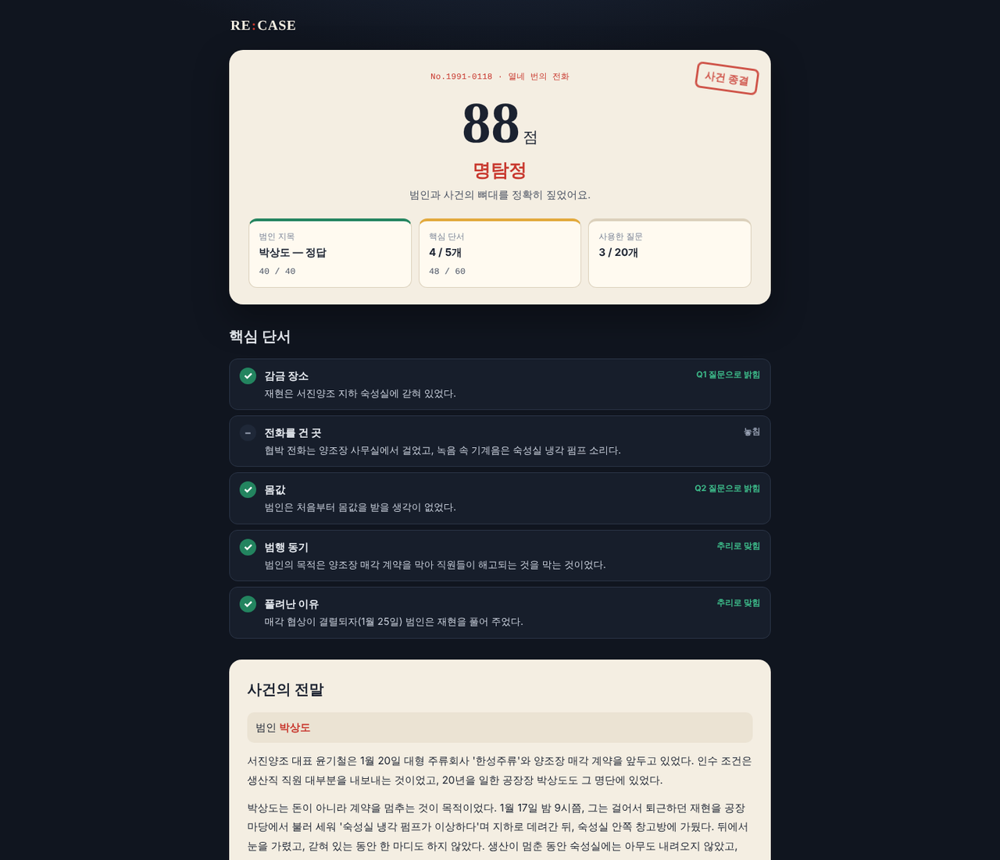
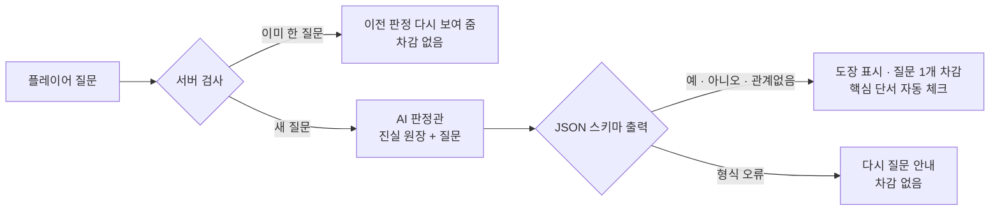
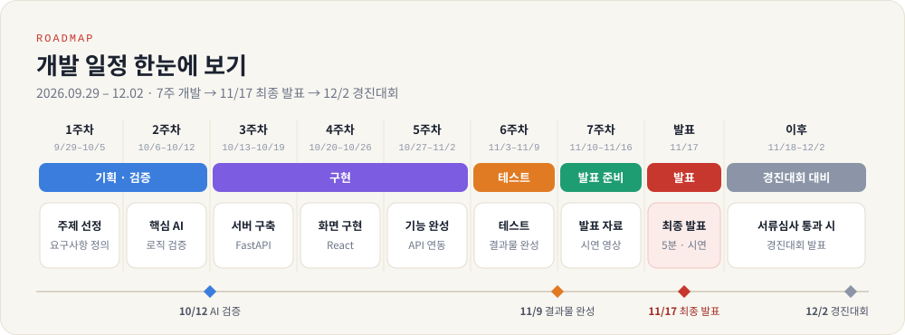

# 🕵️ RE:CASE — 예/아니오로 푸는 미제사건 AI 추리 게임




> **AI 판정관은 사건의 진실을 모두 알고 있지만, “예 · 아니오 · 관계없음”으로만 답합니다.**
> 플레이어는 질문 20개 안에 범인과 사건의 전말을 밝혀내야 합니다.

<br>

## ⚠️ 꼭 읽어 주세요 — 결말은 허구입니다

- RE:CASE의 사건은 **한국에서 실제로 있었던 미제사건**에서 모티프(시대 · 사건 유형)를 얻었습니다.
- 미제사건은 **아직 결말이 없습니다.** 그래서 게임 속 **인물 · 장소 · 결말은 모두 허구**로 새로 만들었습니다.
- 실제 사건명, 피해자 · 유족 · 실존 인물의 이름은 쓰지 않으며, 실제 사건의 진범을 추정하지 않습니다.
- 이 안내는 메인 화면, 수사 시작 직전, 사건 기록철, 결과 화면에 계속 표시됩니다.

<br>

## 📌 목차

1. [프로젝트 개요](#1-프로젝트-개요)
2. [게임 방법](#2-게임-방법)
3. [수록 사건](#3-수록-사건)
4. [실행 방법](#4-실행-방법)
5. [AI 판정 구조](#5-ai-판정-구조)
6. [API](#6-api)
7. [폴더 구조](#7-폴더-구조)
8. [테스트](#8-테스트)
9. [사건 추가하기](#9-사건-추가하기)
10. [개발 일정](#10-개발-일정)

<br>

## 1. 프로젝트 개요

| 항목 | 내용 |
|---|---|
| 프로젝트명 | **RE:CASE (리케이스)** — 닫혀 있던 사건(CASE)을 다시(RE) 연다 |
| 한 줄 소개 | 실제 미제사건을 모티프로 한 가상 사건을, AI 판정관에게 예/아니오 질문을 던지며 푸는 추리 게임 |
| 과목 | 동양미래대학교 컴퓨터소프트웨어공학과 「인공지능프로젝트」 개별 프로젝트 |
| 개발자 | 한준탁 |
| 기술 스택 | React 18 (Vite) · FastAPI · OpenAI API (JSON Schema 구조화 출력) |

<br>

## 2. 게임 방법



1. **사건 기록 읽기** — 왼쪽 사건 기록철에서 개요 · 증거 · 인물을 살펴봅니다.
2. **예/아니오로 묻기** — 가운데 질문실에서 AI 판정관에게 질문합니다. 판정은 도장으로 찍힙니다.
   - `예` · `아니오` · `관계없음` 셋 중 하나로만 답합니다.
   - 질문은 사건마다 **20개**까지. 예/아니오로 답할 수 없는 질문(“누가 범인이야?”), 한 번에 두 가지를 묻는 질문, 이미 한 질문은 **개수에 넣지 않습니다.**
3. **핵심 단서 모으기** — 오른쪽 수사 수첩에 핵심 단서 5개의 제목이 있습니다. 질문으로 단서를 확인하면 자동으로 체크되고, 어떤 질문으로 밝혔는지 표시됩니다.
4. **추리 제출** — 범인을 지목하고 사건의 전말을 씁니다. 제출하면 채점과 함께 진실이 공개됩니다.

**채점** : 범인 40점 (공범을 지목하면 20점) + 핵심 단서 하나당 12점 = **100점 만점**
질문으로 확인하지 못한 단서도 ‘사건의 전말’에 맞게 쓰면 AI 채점관이 점수를 줍니다.



결과 화면에서는 점수와 등급, 핵심 단서별 획득 경로, 사건의 전말, 결정적 질문이 표시된 질문 복기를 볼 수 있습니다.

<br>

## 3. 수록 사건

| 사건 번호 | 제목 | 모티프 | 유형 | 난이도 |
|---|---|---|---|---|
| 1991-0118 | 열네 번의 전화 | 1990년대 초 몸값 협박 전화 미제사건 | 유괴 · 협박 전화 | 보통 |
| 2001-0114 | 눈 위의 발자국 | 2000년대 초 산간 마을 실종 미제사건 | 실종 | 보통 |
| 1998-1017 | 사라진 금동불 | 1990년대 사찰 문화재 도난 미제사건 | 문화재 도난 | 어려움 |

모든 사건은 피해자가 성인이고, 잔혹한 묘사 없이 구성했습니다. (정답은 `backend/data/cases.json`의 `truth`에 있으니 플레이 전에는 열지 마세요!)

<br>

## 4. 실행 방법

**준비물** : Python 3.10 이상, Node.js 18 이상, OpenAI API 키

### 1) 저장소 받기

```bash
git clone https://github.com/Juntak0131/re-case.git
cd re-case
```

### 2) 백엔드 설정 · 실행

```bash
cd backend
python -m venv venv
venv\Scripts\activate             # macOS/Linux: source venv/bin/activate
pip install -r requirements.txt
copy .env.example .env            # macOS/Linux: cp .env.example .env
```

`backend/.env` 파일을 열어 API 키를 넣습니다.

```dotenv
OPENAI_API_KEY=sk-...여기에-키...
OPENAI_MODEL=
```

```bash
uvicorn app.main:app --reload     # http://localhost:8000/docs 에서 API 확인
```

### 3) 프론트엔드 실행 (새 터미널)

```bash
cd frontend
npm install
npm run dev                       # http://localhost:5173 접속
```

### 발표 · 시연용: 서버 하나로 실행

```bash
cd frontend
npm install
npm run build                     # frontend/dist 생성
cd ../backend
uvicorn app.main:app --port 8000
```

빌드한 뒤에는 백엔드가 화면까지 같이 띄워 주므로 **http://localhost:8000** 하나만 열면 됩니다.

### 환경 변수

| 이름 | 설명 |
|---|---|
| `OPENAI_API_KEY` | OpenAI API 키 (필수) |
| `OPENAI_MODEL` | 판정에 쓸 모델. 비우면 `gpt-5-mini`를 쓰고, 그 키로 쓸 수 없는 모델이면 `gpt-4.1-mini` → `gpt-4o-mini` 순서로 자동 전환합니다. |

> 🔒 **API 키 주의** : `.env`는 `.gitignore`에 들어 있어 GitHub에 올라가지 않습니다. 이 저장소는 공개(Public)이므로 **키를 코드 · README · 커밋 메시지에 절대 적지 마세요.** 키가 노출됐다면 바로 폐기하고 새로 발급받아야 합니다.

<br>

## 5. AI 판정 구조



| 설계 | 방법 | 효과 |
|---|---|---|
| **진실 원장** | 사건마다 전말 · 사실 목록(25~29개) · 핵심 단서 5개를 미리 고정해 두고, 판정관은 원장만 근거로 답함 | 플레이마다 답이 흔들리지 않고, 논리적으로 풀 수 있는 사건 보장 |
| **정답 유출 차단** | 진실 원장은 서버에만 두고, 모델 출력은 JSON 스키마의 `enum`(YES/NO/IRRELEVANT/INVALID)으로 묶음 | 프롬프트 인젝션(“정답 알려줘”)을 해도 판정 외의 글이 화면에 나갈 수 없음 |
| **판정 근거(basis)** | 판정 전에 원장의 어느 사실에 근거했는지 한 문장으로 쓰게 함 (서버 로그에만 남김) | 판정 정확도 향상, 오판 디버깅 가능 |
| **핵심 단서 자동 체크** | 질문 + 판정으로 핵심 단서가 분명히 확인되면 해당 ID를 함께 반환 | 진행 상황을 보여 주면서도 단서 내용은 숨김 |
| **AI 채점관** | 제출한 ‘사건의 전말’을 핵심 단서 5개와 비교해 맞게 쓴 단서만 반환 | 표현이 달라도 의미가 같으면 인정 |
| **비용 · 안정성** | 같은 질문은 캐시해서 다시 호출하지 않음, IP당 분당 30회 제한, 질문 150자 제한, 모델 · 파라미터 자동 호환 | 교수님 제공 키를 아껴 쓰고, 모델이 달라도 동작 |

판정 규칙과 프롬프트 전문은 [`backend/app/prompts.py`](backend/app/prompts.py)에 있습니다.

<br>

## 6. API

| Method | Endpoint | 설명 |
|---|---|---|
| `GET` | `/api/health` | 서버 상태 · API 키 설정 여부 |
| `GET` | `/api/cases` | 사건 목록 (공개 정보만) |
| `POST` | `/api/games` | 새 게임 시작 `{ "case_id": "c1991" }` |
| `GET` | `/api/games/{id}` | 게임 상태 (새로고침 후 이어하기) |
| `POST` | `/api/games/{id}/questions` | 질문 `{ "question": "..." }` → 판정 · 남은 질문 · 새로 확인한 단서 |
| `POST` | `/api/games/{id}/accusation` | 추리 제출 `{ "culprit_id": "P3", "explanation": "..." }` → 점수 · 진실 공개 |

추리를 제출하기 전에는 어떤 응답에도 진실 원장이 담기지 않습니다. (테스트로 검증)
게임 세션은 서버 메모리에 보관되므로 서버를 다시 켜면 진행 중인 게임은 초기화됩니다.

<br>

## 7. 폴더 구조

```text
re-case/
├── backend/
│   ├── app/
│   │   ├── main.py          # FastAPI 라우트, 빌드된 화면 서빙
│   │   ├── game.py          # 게임 세션 · 질문 기록 · 채점
│   │   ├── llm.py           # OpenAI 호출 (판정관 · 채점관, 모델 자동 전환)
│   │   ├── prompts.py       # 판정 · 채점 프롬프트와 JSON 스키마
│   │   └── cases.py         # 사건 데이터 로드, 공개용 데이터 분리
│   ├── data/cases.json      # 사건 3개 (공개 정보 + 진실 원장)
│   ├── tests/test_api.py    # 가짜 판정관으로 API 전체 흐름 테스트
│   ├── .env.example         # 환경 변수 예시 (실제 키는 .env에)
│   ├── requirements.txt
│   └── requirements-dev.txt
├── frontend/
│   ├── src/
│   │   ├── App.jsx          # 화면 전환 (메인 → 안내 → 수사 → 결과)
│   │   ├── api.js           # 백엔드 API 호출
│   │   ├── styles.css
│   │   └── components/      # Home · Gate · Play · CaseFile · Notebook · Accuse · Result
│   ├── index.html
│   └── package.json
├── docs/images/
├── .gitignore
└── README.md
```

<br>

## 8. 테스트

실제 OpenAI를 부르지 않고, 가짜 판정관을 끼워서 전체 흐름을 검증합니다.

```bash
cd backend
pip install -r requirements-dev.txt
python -m pytest -q
```

검증 항목 : 사건 데이터 무결성 · 추리 제출 전 진실 미노출 · 질문 차감/반복/형식 오류 처리 · 20개 제한 · 채점(공범 부분 점수 포함) · API 키 없음/잘못된 키 안내 · 지원하지 않는 모델 · 파라미터 자동 전환

<br>

## 9. 사건 추가하기

`backend/data/cases.json`에 객체를 하나 추가하면 됩니다. 서버를 다시 켜면 목록에 나타납니다.

| 필드 | 설명 |
|---|---|
| `id`, `number`, `title`, `era`, `place`, `type`, `motif`, `difficulty` | 사건 기본 정보 (`motif`에는 실제 사건명 대신 시대 · 유형만) |
| `teaser`, `question`, `accuse_label`, `examples` | 카드 소개 문구, 풀어야 할 질문, 지목 질문, 예시 질문 3개 |
| `briefing`, `evidence`, `people` | 플레이어에게 공개되는 개요 · 증거 · 인물 (`people[].id`는 `P1`부터) |
| `truth.culprit`, `truth.accomplice` | 정답 인물 ID, 공범 ID(없으면 `null`) |
| `truth.story`, `truth.epilogue` | 결과 화면에 공개되는 전말과 후일담 |
| `truth.facts` | 판정관이 근거로 삼는 사실 목록 — 플레이어가 물을 만한 것을 빠짐없이, 서로 모순 없게 |
| `truth.keys` | 핵심 단서 5개 (`K1`~`K5`). `title`은 플레이 중에 보이므로 답을 암시하지 않게 |

<br>

## 10. 개발 일정



<br>

---

<div align="center">

**🕵️ RE:CASE** · 동양미래대학교 컴퓨터소프트웨어공학과 「인공지능프로젝트」 · 한준탁
<br>
실제 미제사건에서 모티프를 얻은 가상 시나리오이며, 인물 · 장소 · 결말은 모두 허구입니다.

</div>
