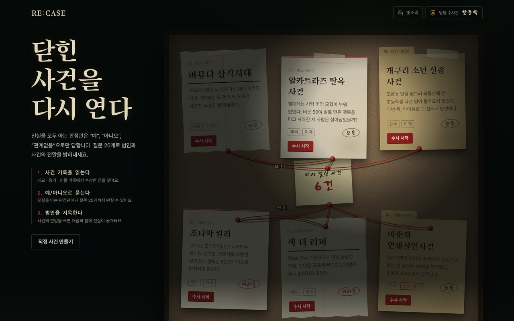
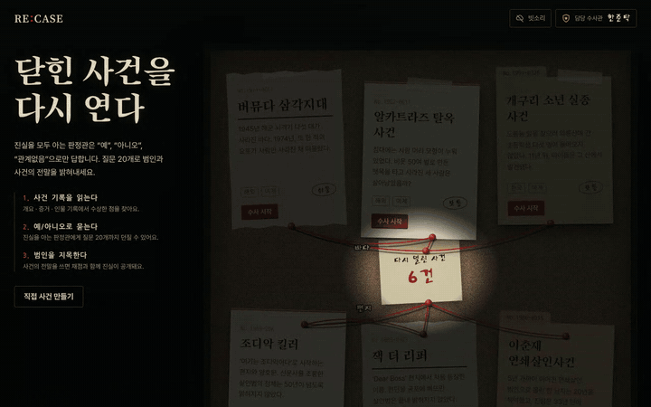
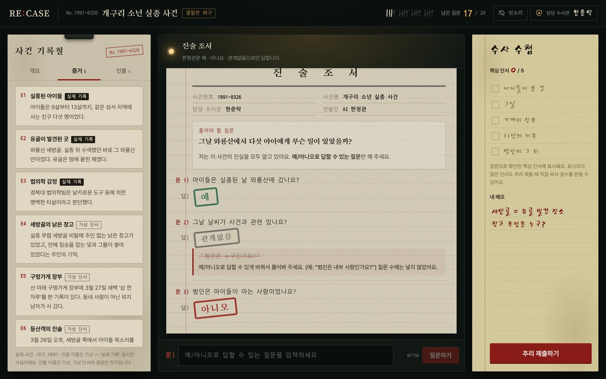
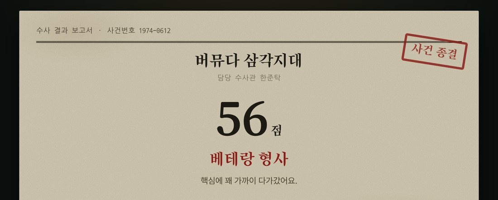
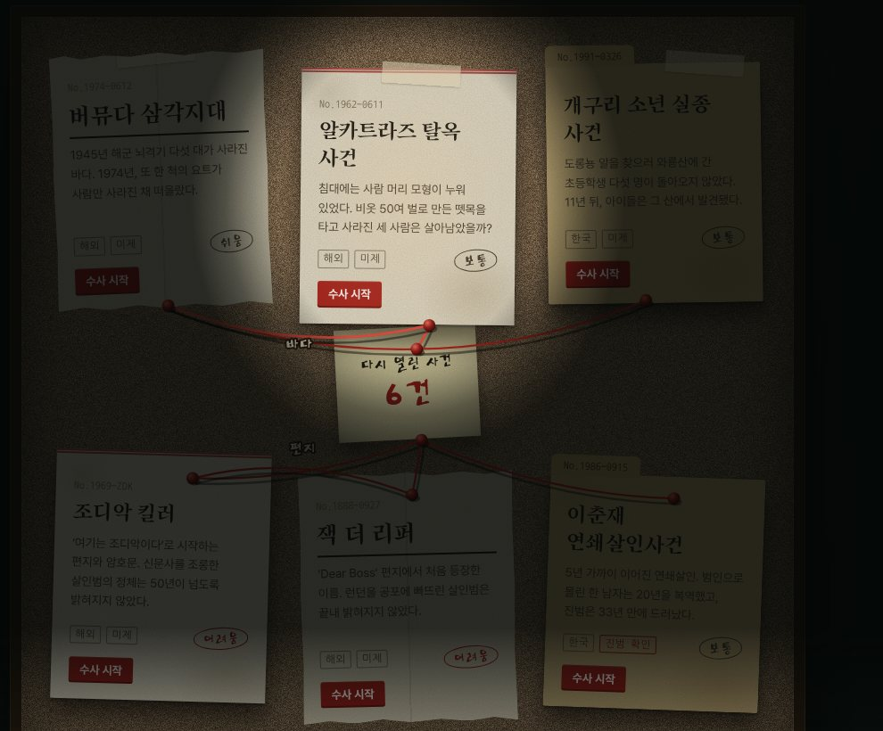
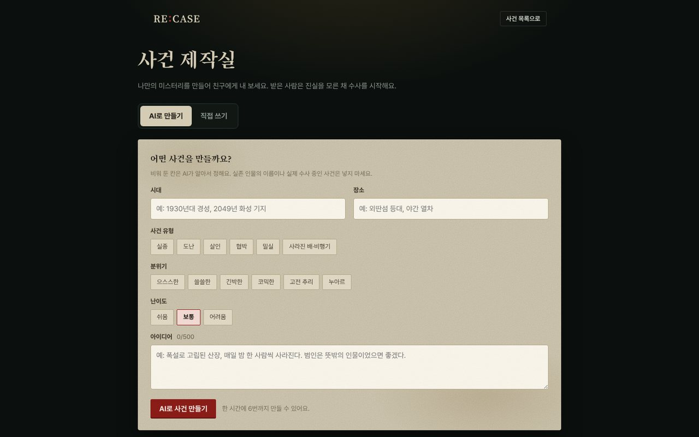
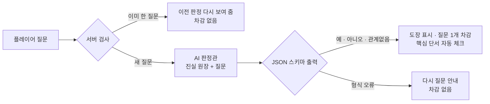
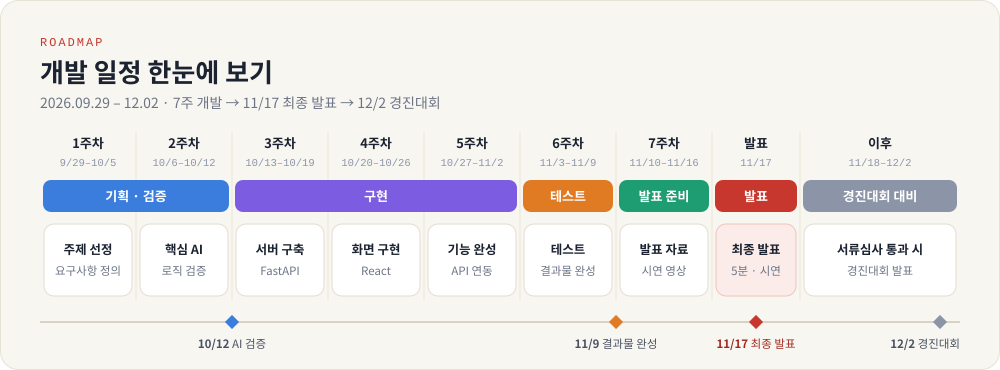

# 🕵️ RE:CASE — 예/아니오로 푸는 미스터리 AI 추리 게임




> **불 꺼진 미제사건 수사본부. 당신은 오늘 밤 닫힌 사건을 다시 여는 담당 수사관입니다.**
> 진실을 모두 아는 AI 판정관은 “예 · 아니오 · 관계없음”으로만 답합니다. 질문 20개 안에 범인과 사건의 전말을 밝혀내세요.
> 버뮤다 삼각지대, 조디악 킬러, 개구리 소년 실종 사건까지 — 누구나 들어 본 실제 사건 6개가 기다리고 있고, 직접 만든 사건을 링크로 친구에게 낼 수도 있어요.

<br>

## ⚠️ 꼭 읽어 주세요 — 무엇이 사실이고 무엇이 허구인가

| 사건 종류 | 사실 | 허구 |
|---|---|---|
| **아직 풀리지 않은 실제 사건** (버뮤다 · 알카트라즈 · 조디악 · 잭 더 리퍼 · 개구리 소년) | 사건 이름, 개요, ‘실제 기록’ 표시가 붙은 증거 | **등장인물 이름(‘가상 이름’ 표시), ‘가상 단서’, 범인과 결말** |
| **진범이 밝혀진 실제 사건** (이춘재 연쇄살인사건) | 사건 이름, 수사 경과와 결말 (공개된 수사 기록 그대로) | **등장인물 이름만 가명** |
| **사용자 사건** | — | 사용자가 만든 가상의 사건 |

- 풀리지 않은 사건에는 결말이 없기 때문에, 게임의 범인과 결말은 새로 지었습니다. **게임의 결말을 실제 사건의 진실로 받아들이지 말아 주세요.** 이 안내는 메인 화면, 수사 시작 직전, 사건 기록철, 결과 화면에 계속 표시됩니다.
- **실제 피해자 · 유가족 · 수사 관계자의 이름은 쓰지 않습니다.** 한국 사건은 잔혹한 묘사 없이 수사 기록 중심으로만 다루고, 풀리지 않은 사건의 가상 범인은 유가족 · 실존 인물과 관계없는 인물로 만들었습니다.
- 지금 수사 · 재판이 진행 중인 최근 사건은 다루지 않습니다.

<br>

## 📌 목차

1. [프로젝트 개요](#1-프로젝트-개요)
2. [화면과 분위기](#2-화면과-분위기)
3. [게임 방법](#3-게임-방법)
4. [수록 사건](#4-수록-사건)
5. [사건 제작실](#5-사건-제작실)
6. [실행 방법](#6-실행-방법)
7. [OpenAI 사용량과 비용](#7-openai-사용량과-비용)
8. [AI 구조와 안전장치](#8-ai-구조와-안전장치)
9. [API](#9-api)
10. [폴더 구조](#10-폴더-구조)
11. [테스트](#11-테스트)
12. [개발 일정](#12-개발-일정)

<br>

## 1. 프로젝트 개요

| 항목 | 내용 |
|---|---|
| 프로젝트명 | **RE:CASE (리케이스)** — 닫혀 있던 사건(CASE)을 다시(RE) 연다 |
| 한 줄 소개 | 실제 미스터리와 미제사건을 바탕으로 한 사건을, AI 판정관에게 예/아니오 질문을 던지며 푸는 추리 게임 |
| 과목 | 동양미래대학교 컴퓨터소프트웨어공학과 「인공지능프로젝트」 개별 프로젝트 |
| 개발자 | 한준탁 |
| 기술 스택 | React 18 (Vite) · FastAPI · SQLite · OpenAI API (JSON Schema 구조화 출력, 모더레이션) |
| 디자인 | **미제사건 수사본부의 밤** — 어두운 코르크 증거 보드, 고른 사건에만 켜지는 조명, 진술 조서, 형사의 손글씨 수첩 |

<br>

## 2. 화면과 분위기



| 화면 | 연출 |
|---|---|
| **증거 보드** (메인) | 불 꺼진 수사본부의 코르크 보드에 사건 6개가 빨간 실로 이어져 있어요. 처음엔 어둡고, **사건 카드를 가리키면 그 카드에만 조명이 켜집니다.** 사건을 고르면 방 전체가 한 번 환해진 뒤 사건 기록이 열려요. 휴대폰에서는 화면 가운데 온 카드에 불이 들어와요. |
| **진술 조서** (수사) | 질문과 판정이 경찰 조서처럼 `문 1) … / 답) [예]` 형식으로 타자기 글씨로 쌓이고, 판정은 잉크 도장으로 찍혀요. 남은 질문은 바를 정(正) 표시로 줄어듭니다. |
| **수사 수첩** | 질문으로 확인한 핵심 단서에 체크와 밑줄이 그어지고, 떠오른 생각을 손글씨 메모로 남길 수 있어요. |
| **수사 결과 보고서** | 점수 · 등급과 함께 사건의 전말이 보고서로 공개됩니다. |
| **담당 수사관** | 화면 위쪽에서 내 이름을 등록하면 조서 · 안내문 · 보고서에 이름이 찍혀요. (이 브라우저에만 저장) |
| **빗소리** | 버튼을 누르면 브라우저에서 직접 만든 빗소리가 깔려요. 기본은 꺼져 있어요. |

| 글꼴 | 쓰임 |
|---|---|
| 송명 | 사건 제목, 기록 본문 — 옛 인쇄물 |
| 나눔고딕코딩 | 진술 조서, 사건번호 — 타자기 |
| 독도 | 수사 수첩, 메모 — 형사의 손글씨 |
| Pretendard | 버튼, 안내문 |

글꼴은 모두 npm 패키지로 포함해서 인터넷이 없어도 같은 모양으로 보입니다. 기기에서 ‘동작 줄이기’를 켜 두면 깜빡임 · 조명 이동 같은 움직임 없이 바로 바뀌어요.

<br>

## 3. 게임 방법



1. **사건 기록 읽기** — 왼쪽 사건 기록철에서 개요 · 증거 · 인물을 살펴봅니다.
2. **예/아니오로 묻기** — 가운데 진술 조서에서 AI 판정관에게 질문합니다. 판정은 도장으로 찍힙니다.
   - `예` · `아니오` · `관계없음` 셋 중 하나로만 답합니다.
   - 질문은 사건마다 **20개**까지. 예/아니오로 답할 수 없는 질문, 한 번에 두 가지를 묻는 질문, 이미 한 질문은 **개수에 넣지 않습니다.**
3. **핵심 단서 모으기** — 오른쪽 수사 수첩에 핵심 단서 5개의 제목이 있습니다. 질문으로 확인하면 자동으로 체크되고, 손글씨 메모도 남길 수 있어요.
4. **추리 제출** — 범인을 지목하고 사건의 전말을 쓰면 채점과 함께 진실이 공개됩니다.

**채점** : 범인 40점 (공범을 지목하면 20점) + 핵심 단서 하나당 12점 = **100점 만점**
질문으로 확인하지 못한 단서도 ‘사건의 전말’에 맞게 쓰면 AI 채점관이 점수를 줍니다.



<br>

## 4. 수록 사건



| 구분 | 사건 | 시기 · 장소 | 결말 | 난이도 |
|---|---|---|---|---|
| 해외 미스터리 | 버뮤다 삼각지대 | 1974, 대서양 (전설 속 가상의 요트 세이렌호) | 허구 | 쉬움 |
| 해외 미스터리 | 알카트라즈 탈옥 사건 | 1962, 미국 샌프란시스코 | 허구 | 보통 |
| 해외 미스터리 | 조디악 킬러 | 1968~69, 미국 캘리포니아 | 허구 | 어려움 |
| 해외 미스터리 | 잭 더 리퍼 | 1888, 영국 런던 | 허구 | 어려움 |
| 한국 사건 | 개구리 소년 실종 사건 | 1991, 대구 | 허구 | 보통 |
| 한국 사건 | 이춘재 연쇄살인사건 | 1986~1991, 경기 화성 | **실제 기록** (2019년 진범 확인) | 보통 |

정답은 `backend/data/cases.json`의 `truth`에 있으니 플레이 전에는 열지 마세요!

**실제 기록 출처** (‘실제 기록’ 표시는 아래 자료로 확인한 사실만 썼어요)
- 버뮤다 삼각지대 : [National Geographic](https://www.nationalgeographic.com/history/article/bermuda-triangle-mystery-disappearance)
- 알카트라즈 탈옥 : [FBI — Alcatraz Escape](https://www.fbi.gov/history/famous-cases/alcatraz-escape)
- 조디악 킬러 : [Britannica — Zodiac killer](https://www.britannica.com/biography/Zodiac-killer)
- 잭 더 리퍼 : [History Hit — 10 Facts About Jack the Ripper](https://www.historyhit.com/facts-about-jack-the-ripper/)
- 개구리 소년 실종 사건 : [뉴시스 — 32주기 추모제](https://www.newsis.com/view/NISX20230326_0002241113), [서울신문 — 경찰청장 재수사 발표(2019)](https://m.go.seoul.co.kr/news/2019/09/20/20190920500093)
- 이춘재 연쇄살인사건 : [뉴시스 — 1986~1991 사건일지](https://www.newsis.com/view/NISX20200702_0001081443), [YTN — 경찰 최종 수사 결과](https://www.ytn.co.kr/_ln/0103_202007021644315278), [더팩트 — 8차 사건 재심 무죄](https://news.tf.co.kr/read/ogmeta/1832217.htm)

<br>

## 5. 사건 제작실



| 기능 | 설명 |
|---|---|
| **AI로 만들기** | 시대 · 장소 · 사건 유형 · 분위기 · 난이도 · 아이디어를 고르면 AI가 사건 파일과 진실 원장(사실 20~30개, 핵심 단서 5개)까지 설계합니다. 만든 사람도 진실을 모른 채 바로 플레이할 수 있어요. |
| **직접 쓰고 AI 검사** | 사건 개요 · 증거 · 인물 · 진실 원장을 직접 쓰면, AI 검수관이 모순 · 빠진 사실 · 스포일러 · 난이도를 짚어 줍니다. ‘예시로 채우기’로 형식을 바로 볼 수 있어요. |
| **링크 · 코드 공유** | 저장하면 `http://주소/?case=코드` 링크와 8자리 코드가 생깁니다. 받은 사람은 진실을 볼 수 없고 바로 수사를 시작해요. 메인 화면에서 코드로도 열 수 있어요. |
| **수정 · 삭제** | 만들 때 받은 수정 키(이 브라우저에만 저장)로만 진실 열람 · 수정 · 삭제가 됩니다. |

<br>

## 6. 실행 방법

**준비물** : Python 3.10 이상, Node.js 18 이상, OpenAI API 키

### 1) 저장소 받기

```bash
git clone https://github.com/Juntak0131/re-case.git
cd re-case
```

### 2) API 키 넣기

```bash
copy backend\.env.example backend\.env      # macOS/Linux: cp backend/.env.example backend/.env
notepad backend\.env                        # macOS: open -e backend/.env
```

```dotenv
OPENAI_API_KEY=sk-...여기에-키...
OPENAI_MODEL=
```

### 3) 화면 빌드

```bash
cd frontend
npm install
npm run build
cd ..
```

> 저장소를 새로 받거나 업데이트했을 때도 이 단계를 다시 해 주세요. (글꼴 패키지가 바뀌면 `npm install`이 필요해요)

### 4) 서버 설치 · 실행

```bash
cd backend
python -m venv venv
venv\Scripts\python -m pip install -r requirements.txt        # macOS/Linux: venv/bin/python ...
venv\Scripts\python -m uvicorn app.main:app --port 8000
```

브라우저에서 **http://localhost:8000** 을 열면 됩니다. 다음부터는 4)의 마지막 줄만 실행하면 돼요.

> 화면을 고치며 개발할 때는 서버를 켠 채로 `cd frontend && npm run dev` → http://localhost:5173

### 환경 변수

| 이름 | 설명 |
|---|---|
| `OPENAI_API_KEY` | OpenAI API 키 (필수) |
| `OPENAI_MODEL` | 비우면 `gpt-6-luna`. 그 키로 쓸 수 없는 모델이면 `gpt-5-mini` → `gpt-4.1-mini` → `gpt-4o-mini` 순서로 자동 전환 |
| `RECASE_DB` | 사용자 사건 저장 위치 (기본 `backend/data/user_cases.db`, `.gitignore`에 포함) |

> 🔒 **API 키 주의** : `.env`는 `.gitignore`에 들어 있어 GitHub에 올라가지 않습니다. 이 저장소는 공개(Public)이므로 **키를 코드 · README · 커밋 · 채팅에 절대 적지 마세요.** GitHub 웹 업로드는 `.gitignore`를 거르지 않을 수 있으니, 실행하던 폴더가 아니라 깨끗한 복사본을 올려 주세요.

<br>

## 7. OpenAI 사용량과 비용

**토큰 길이 한계는 문제되지 않습니다.** 질문 판정 한 번의 입력은 약 4~5천 토큰, 사건 생성 출력은 1만 토큰 안팎인데, 모델의 입력 한도는 40만~105만 토큰, 최대 출력은 12.8만 토큰입니다.

| 모델 | 100만 토큰당 입력 / 출력 | 한 판 (질문 20개 + 채점) | 사건 1개 생성 |
|---|---|---|---|
| gpt-6-luna (기본값) | $0.10 / $0.50 | 약 $0.01~0.02 | 약 $0.01 |
| gpt-5-mini | $0.25 / $2.00 | 약 $0.04 | 약 $0.02~0.03 |

실제로 막힐 수 있는 것은 **키의 사용 한도(크레딧)**, **분당 요청 · 토큰 한도**, **계정 등급(Free 등급은 위 모델 사용 불가)** 입니다. 같은 질문은 캐시해서 다시 부르지 않고, IP당 질문 분당 30회 · 사건 생성 시간당 6회로 제한해 키를 아껴 씁니다. (가격 출처: [OpenAI 모델 문서](https://developers.openai.com/api/docs/models))

<br>

## 8. AI 구조와 안전장치



| 설계 | 방법 | 효과 |
|---|---|---|
| **진실 원장** | 사건마다 전말 · 사실 목록 · 핵심 단서 5개를 고정하고, 판정관은 원장만 근거로 답함 | 답이 흔들리지 않고, 논리적으로 풀 수 있는 사건 |
| **정답 유출 차단** | 원장은 서버에만 두고, 판정 출력은 JSON 스키마 `enum`으로 묶음 | “정답 알려줘” 같은 프롬프트 인젝션에도 판정 외의 글이 나가지 않음 |
| **실제 / 가상 구분** | 증거 · 인물에 ‘실제 기록’ · ‘가상 단서’ · ‘가상 이름’ 표시, 판정관에게도 같은 표시와 “원장 밖의 사실을 끌어오지 말 것”을 전달 | 허구가 사실처럼 읽히지 않고, 판정관이 실제 사건 지식으로 답을 흐리지 않음 |
| **사건 생성 · 검수** | 생성은 사건 전체를 JSON 스키마로 받고 형식이 어긋나면 한 번 더 생성, 직접 쓴 사건은 AI 검수관이 문제 목록으로 돌려줌 | 플레이 가능한 사건만 저장 |
| **사용자 사건 안전장치** | OpenAI 모더레이션(성적 · 혐오 · 잔혹 묘사 차단, 범죄 소재 자체는 허용) + AI 검토에서 실존 인물 · 실제 수사 중 사건 · 미성년자 피해 사건 차단 | 친구에게 공유해도 안전한 사건만 |
| **수정 키** | 사건마다 무작위 수정 키 발급, 서버에는 해시만 저장 | 링크를 받은 사람은 진실을 보거나 고칠 수 없음 |

판정 · 채점 프롬프트는 [`backend/app/prompts.py`](backend/app/prompts.py), 생성 · 검수 프롬프트는 [`backend/app/studio.py`](backend/app/studio.py)에 있습니다.

<br>

## 9. API

| Method | Endpoint | 설명 |
|---|---|---|
| `GET` | `/api/health` | 서버 상태 · API 키 설정 여부 · 사용 모델 |
| `GET` | `/api/cases` | 기본 사건 목록 (공개 정보만) |
| `GET` | `/api/cases/{id}` | 사건 요약 (기본 · 사용자 사건, 공유 링크용) |
| `POST` | `/api/games` | 새 게임 `{ "case_id": "alcatraz" }` |
| `GET` | `/api/games/{id}` | 게임 상태 (새로고침 후 이어하기) |
| `POST` | `/api/games/{id}/questions` | 질문 → 판정 · 남은 질문 · 새로 확인한 단서 |
| `POST` | `/api/games/{id}/accusation` | 추리 제출 → 점수 · 진실 공개 |
| `POST` | `/api/studio/generate` | AI 사건 생성 → 사건 코드 · 수정 키 |
| `POST` | `/api/studio/review` | 직접 쓴 사건 AI 검사 (저장 안 함) |
| `POST` | `/api/studio/cases` | 직접 쓴 사건 저장 → 사건 코드 · 수정 키 |
| `GET` · `PUT` · `DELETE` | `/api/studio/cases/{id}` | 진실 포함 열람 · 수정 · 삭제 (`X-Edit-Key` 헤더 필요) |

추리를 제출하기 전에는 어떤 게임 응답에도 진실 원장이 담기지 않습니다. (테스트로 검증)
게임 진행 상황은 서버 메모리에 있어서 서버를 다시 켜면 초기화되고, 사용자 사건은 SQLite에 남습니다.

<br>

## 10. 폴더 구조

```text
re-case/
├── backend/
│   ├── app/
│   │   ├── main.py          # FastAPI 라우트, 속도 제한, 빌드된 화면 서빙
│   │   ├── game.py          # 게임 세션 · 질문 기록 · 채점
│   │   ├── llm.py           # OpenAI 호출 (판정 · 채점 · 생성 · 검수 · 모더레이션, 모델 자동 전환)
│   │   ├── prompts.py       # 판정 · 채점 프롬프트와 JSON 스키마
│   │   ├── studio.py        # 사건 제작실: 생성 · 검수 프롬프트, 사건 형식 정리 · 검사
│   │   ├── store.py         # 사용자 사건 저장소 (SQLite, 수정 키 해시)
│   │   └── cases.py         # 기본 · 사용자 사건 조회, 공개용 데이터 분리
│   ├── data/cases.json      # 기본 사건 6개 (공개 정보 + 진실 원장)
│   ├── tests/               # 가짜 AI로 게임 · 제작실 전체 흐름 테스트
│   ├── .env.example
│   ├── requirements.txt
│   └── requirements-dev.txt
├── frontend/
│   ├── src/
│   │   ├── App.jsx          # 화면 전환 · 공유 링크 처리 · 내 사건 목록 · 수사관 이름
│   │   ├── api.js
│   │   ├── ambience.js      # 빗소리 (음원 파일 없이 브라우저에서 생성)
│   │   ├── styles.css       # 미제사건 수사본부 디자인 (증거 보드 조명 · 진술 조서 · 손글씨 수첩)
│   │   └── components/      # Home(증거 보드) · Gate · Play(진술 조서) · CaseFile · Notebook · Accuse · Result · Studio · Chrome(수사관 이름표 · 빗소리)
│   └── package.json
├── docs/images/
├── .gitignore
└── README.md
```

<br>

## 11. 테스트

실제 OpenAI를 부르지 않고 가짜 AI를 끼워서 검증합니다. (19개)

```bash
cd backend
venv\Scripts\python -m pip install -r requirements-dev.txt
venv\Scripts\python -m pytest -q
```

검증 항목 : 사건 데이터 무결성(실제 기록 · 가상 이름 표시, 진범 확인 사건 표시 포함) · 추리 제출 전 진실 미노출 · 질문 차감/반복/형식 오류 · 20개 제한 · 채점 · AI 사건 생성 · 생성 형식 오류 재시도 · 공유 링크 플레이 · 수정 키 권한 · 모더레이션 · 실존 인물 차단 · 속도 제한 · API 키 없음/잘못된 키/한도 초과 안내 · 모델 · 파라미터 자동 전환

<br>

## 12. 개발 일정



<br>

---

<div align="center">

**🕵️ RE:CASE** · 동양미래대학교 컴퓨터소프트웨어공학과 「인공지능프로젝트」 · 한준탁
<br>
실제 사건을 바탕으로 재구성한 게임입니다. 등장인물 이름은 가상이고, 풀리지 않은 사건의 범인과 결말은 허구입니다.

</div>
